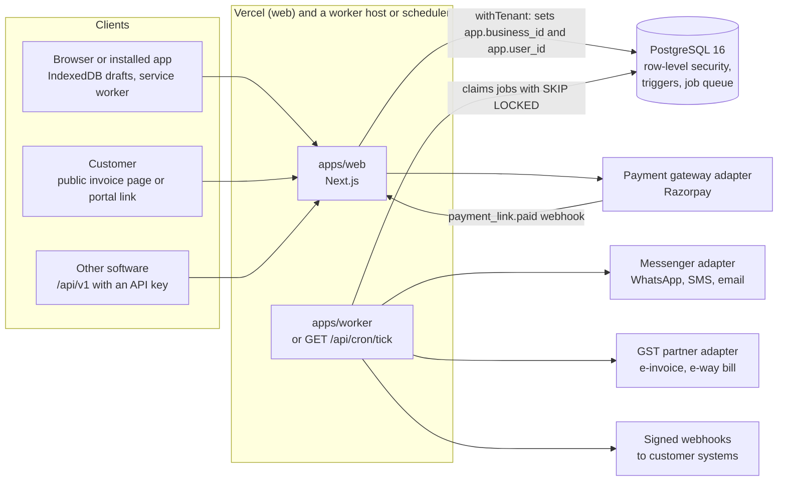
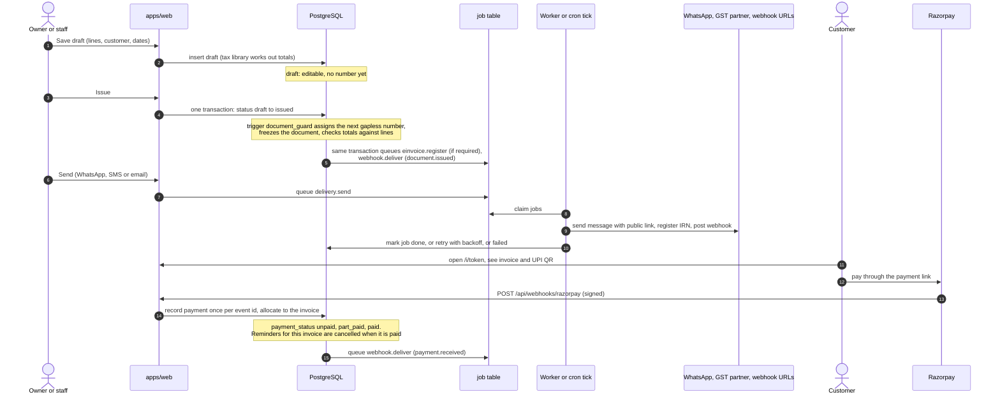

# Architecture

Kora is a pnpm monorepo. A Next.js app serves the screens and the API, a small worker (or a scheduler calling one route) does background work, and one PostgreSQL database enforces the rules that make an invoice legal. This page is the map. Details live next to the code, and the table list is in [database.md](database.md).

## Packages

| Folder | Role | Depends on |
|---|---|---|
| `packages/tax` | Pure tax and money library: CGST, SGST, IGST and cess in integer paise (`bigint`), place of supply, GSTIN checksum, payment terms. No database, no network | nothing |
| `packages/db` | SQL migrations, `withTenant()`, `runMigrations()`, test database helper, the schema reference generator | `postgres` |
| `packages/core` | Services that talk to the database: documents, payments, parties, items, auth, team, e-invoice, e-way bill, GSTR data, purchases, portal, importer, exports, jobs, reminders, recurring, webhooks | `db`, `tax`, `adapters` |
| `packages/adapters` | Interfaces and implementations for everything outside: OTP sender, messenger (WhatsApp, SMS, email), payment gateway (Razorpay), GST partner client, GSTIN lookup, e-way bill rules, and the mock partner server | `tax` |
| `packages/pdf` | Invoice HTML, PDF through headless Chromium, UPI QR and e-invoice QR, receipts and statements | `tax` |
| `apps/web` | Next.js 15 app: marketing pages, help centre, the signed-in app under `/app`, `/api/*` routes, the public API `/api/v1`, public invoice page `/i/[token]`, customer portal `/portal`, installable PWA | all packages |
| `apps/worker` | Long-running process: reminders and recurring invoices on a timer, then the job queue | `core`, `adapters` |
| `apps/mock-gsp` | The mock GST partner as a small HTTP server, for development and staging | `adapters` |
| `e2e` | Playwright browser tests against a production build | |
| `infra` | Local database roles, SQL smoke test, backup and restore-check scripts | |
| `apps/desktop`, `apps/mobile` | Electron and Capacitor shells around the web app. Outside the workspace on purpose | |



## An invoice from draft to paid



States of a document: `draft`, `issued`, `cancelled`. After issue nothing on it can be edited or deleted; corrections are a credit note or a debit note that point at it. The payment state is separate and derived from what has been allocated: `unpaid`, `part_paid`, `paid`.

## Tenant isolation with row-level security

A business is a tenant. Every tenant table has a `business_id` column and a policy of this shape (`packages/db/migrations/0002_auth_and_tenancy.sql`, `0007_authz.sql`):

```sql
using (business_id = current_business() and (select is_authorized()))
```

- The web app connects as the `kora_web` role, which is not a superuser and has no `BYPASSRLS`. Migrations run as `kora_owner`, which does bypass it. The role split is created by `infra/init-roles.sql` locally and by hand in production ([deploy.md](deploy.md)).
- Every request that reads or writes tenant data goes through `withTenant()` (`packages/db/src/index.ts`) or `inTenant()` in `packages/core/src/tenancy.ts`. That opens a transaction and sets two values that last only for that transaction: `app.business_id` and `app.user_id`. `current_business()` and `current_actor()` read them.
- `is_authorized()` also checks that the user is still a member of the business, so removing a person ends their access at the database, not only in the screens.
- Roles (owner, staff, accountant) are checked in `packages/core/src/permissions.ts` before the work starts, and the rules that matter are repeated in the database.
- The audit log is append-only. The application role cannot update or delete it, and a trigger blocks `truncate`.
- A connection pooler in transaction mode is fine, because the two settings are `set_config(..., true)` inside the transaction.

At the time of writing, 58 of 71 tables have row-level security (`pnpm --filter @kora/db erd` prints the count). The other 13 are not tenant data by nature, or are system tables touched only by server code:

| Group | Tables |
|---|---|
| Reference data | `state_code`, `tax_rate`, `schema_migration` |
| Sign-in and security | `app_user`, `app_session`, `otp_challenge`, `mfa_challenge`, `user_totp`, `user_recovery_code`, `security_event`, `rate_event` |
| System queues | `job`, `webhook_event` |

The application role can read and write the system queue tables directly, and they hold payloads for every business. They are reached only by code in `packages/core` that no request parameter can steer. Treat a new query against them as a security review item.

## Where the money rules live

Rule of the project: **money is integer paise, never a floating point number.** In SQL it is `bigint`. In TypeScript it is `bigint` (the tax library) or a decimal string that is parsed to `bigint`. In JSON the API returns paise as strings (`"118000"`).

| Rule | Where it is enforced |
|---|---|
| Tax, rounding, place of supply, TCS and TDS | `packages/tax/src/compute.ts` and `rules.ts`. Pure functions, tested with 10,000-run property tests (`packages/tax/test/property.test.ts`) and a cross-check against the database |
| Numbers are gapless per series and financial year, assigned at issue | `document_guard` trigger and `number_series` (`0001_init.sql`). A rolled-back issue never uses a number |
| Issued documents cannot be edited or deleted, and their lines are frozen | `document_guard` (document) and `line_guard` (lines) triggers |
| Totals on the document equal the sum of its lines, and a document needs at least one line | Checked by `document_guard` at the moment of issue |
| A tax invoice needs a GSTIN and a place of supply; composition dealers issue a bill of supply | `document_guard` |
| Credit and debit notes must point at an issued invoice | `document_guard` (database) |
| A credit note cannot take back more than was invoiced | The application, in `packages/core/src/documents.ts`. This one is not a database rule |
| Payments are applied once, never more than the payment, only to issued invoices | `allocation_guard`, a unique `webhook_event` id, `packages/core/src/payments.ts` |
| Business GSTIN and state cannot change after documents are issued | `business_freeze_identity` trigger |
| Everything is written to an audit log | `audit_row` triggers, `audit_block_change` |
| Rupees in, paise out | `parseRupees()` and `formatMoney()` in `packages/tax/src/money.ts` |

The application checks all of these too, so a person sees a plain-words message. The database checks them so that a bug in the application cannot break them.

## Background work: the worker and the cron tick

Work that must happen because something changed is put in the `job` table **in the same transaction** as the change (`enqueue()` in `packages/core/src/jobs.ts`). Four queues exist (`packages/core/src/handlers.ts`):

| Queue | Does |
|---|---|
| `delivery.send` | Sends an invoice or reminder on WhatsApp, SMS or email |
| `statement.send` | Sends a customer statement |
| `einvoice.register` | Registers an e-invoice with the GST partner |
| `webhook.deliver` | Posts a signed event to a customer's address |

A job is claimed with `claim_jobs()` (`FOR UPDATE SKIP LOCKED`), so any number of workers can run at once without doing the same job twice. A failing job goes back to `queued` with a delay of 30 seconds, doubling, up to an hour, with a little jitter. After 8 tries, or on a permanent error, it becomes `failed`. `POST /api/admin/jobs` puts failed jobs back.

Two ways to run the queue:

- **The worker** (`apps/worker/src/index.ts`): a loop that every 30 seconds queues due reminders, every 60 seconds queues due recurring invoices, and runs ready jobs continuously. It serves `/healthz` when `WORKER_HEALTH_PORT` is set. Run two for availability. The `Dockerfile` builds one image for both the web app and the worker.
- **The cron tick** (`GET /api/cron/tick`, `packages/core/src/tick.ts`): the same work in one pass of up to 40 seconds, called by a scheduler with `Authorization: Bearer <CRON_SECRET>`. This is for hosts with no always-on process. `apps/web/vercel.json` calls it once a day at 10:00 IST; a faster schedule is a deployment decision (see [launch-checklist.md](launch-checklist.md), section 11).

Both are safe to run at the same time. Reminders are queued by `processDueReminders`, and a reminder is cancelled by a trigger when its invoice is paid.

## Adapters and mocks

Everything outside the system sits behind an interface in `packages/adapters`, chosen by an environment variable when the process starts:

| Concern | Variable | Mock | Live |
|---|---|---|---|
| Sign-in codes | `OTP_PROVIDER` | prints to the console | MSG91 (SMS), Resend (email) |
| Messages | `MESSENGER` | logs in memory | WhatsApp Cloud API, MSG91, Resend |
| Payments | `GATEWAY` | pays on a page inside the app | Razorpay Payment Links |
| GST partner | `GSP_URL` | `apps/mock-gsp` | a generic JSON client; no real partner is mapped yet |
| GSTIN lookup | none | always a mock | none yet |

In production every mock refuses to start unless `KORA_ALLOW_MOCKS=1`, so a mock cannot be left on by accident.

## Clients

The screens under `/app` are client components that call `/api/*` with a session cookie (`kora_session`) and a business cookie (`kora_business`). Drafts made offline are kept in IndexedDB and synced when the network returns, with a conflict screen (`apps/web/app/app/invoices/offline`). The public API under `/api/v1` is separate: it uses API keys, a stable error shape and its own rate limit, and is described in [api.md](api.md) and `apps/web/public/openapi.json`. A test keeps those two in step with the routes.
