# Database

Generated by `pnpm --filter @kora/db erd` from the migrated schema. Do not edit by hand.

71 tables. 58 have row-level security, which is how one business is kept away from another.

```mermaid
erDiagram
  app_user ||--o{ api_key : ""
  business ||--o{ api_key : ""
  app_user ||--o{ app_session : ""
  state_code ||--o{ business : ""
  app_user ||--o{ client_fund_entry : ""
  business ||--o{ client_fund_entry : ""
  document ||--o{ client_fund_entry : ""
  matter ||--o{ client_fund_entry : ""
  business ||--o{ contact_person : ""
  party ||--o{ contact_person : ""
  business ||--o{ custom_field_def : ""
  app_user ||--o{ data_export : ""
  business ||--o{ data_export : ""
  business ||--o{ delivery : ""
  document ||--o{ delivery : ""
  app_user ||--o{ document : ""
  business ||--o{ document : ""
  document ||--o{ document : ""
  number_series ||--o{ document : ""
  party ||--o{ document : ""
  state_code ||--o{ document : ""
  app_user ||--o{ document_comment : ""
  business ||--o{ document_comment : ""
  document ||--o{ document_comment : ""
  app_user ||--o{ document_file : ""
  business ||--o{ document_file : ""
  document ||--o{ document_file : ""
  business ||--o{ document_line : ""
  document ||--o{ document_line : ""
  item ||--o{ document_line : ""
  tax_rate ||--o{ document_line : ""
  business ||--o{ document_template : ""
  app_user ||--o{ document_write_off : ""
  business ||--o{ document_write_off : ""
  document ||--o{ document_write_off : ""
  business ||--o{ einvoice : ""
  document ||--o{ einvoice : ""
  app_user ||--o{ estimate_state : ""
  business ||--o{ estimate_state : ""
  document ||--o{ estimate_state : ""
  business ||--o{ eway_bill : ""
  document ||--o{ eway_bill : ""
  app_user ||--o{ expense : ""
  business ||--o{ expense : ""
  document ||--o{ expense : ""
  party ||--o{ expense : ""
  business ||--o{ expense_receipt : ""
  expense ||--o{ expense_receipt : ""
  business ||--o{ gstr2b_entry : ""
  purchase_bill ||--o{ gstr2b_entry : ""
  business ||--o{ inbox_file : ""
  inbox_item ||--o{ inbox_file : ""
  app_user ||--o{ inbox_item : ""
  business ||--o{ inbox_item : ""
  business ||--o{ item : ""
  tax_rate ||--o{ item : ""
  business ||--o{ late_fee_charge : ""
  document ||--o{ late_fee_charge : ""
  app_user ||--o{ matter : ""
  business ||--o{ matter : ""
  party ||--o{ matter : ""
  app_user ||--o{ matter_access : ""
  business ||--o{ matter_access : ""
  matter ||--o{ matter_access : ""
  app_user ||--o{ matter_entry : ""
  business ||--o{ matter_entry : ""
  document ||--o{ matter_entry : ""
  matter ||--o{ matter_entry : ""
  app_user ||--o{ matter_event : ""
  business ||--o{ matter_event : ""
  matter ||--o{ matter_event : ""
  app_user ||--o{ member : ""
  business ||--o{ member : ""
  app_user ||--o{ mfa_challenge : ""
  app_user ||--o{ network_invoice : ""
  business ||--o{ network_invoice : ""
  purchase_bill ||--o{ network_invoice : ""
  app_user ||--o{ network_order : ""
  business ||--o{ network_order : ""
  business ||--o{ network_profile : ""
  business ||--o{ number_series : ""
  business ||--o{ onboarding_step : ""
  business ||--o{ party : ""
  party ||--o{ party : ""
  price_list ||--o{ party : ""
  state_code ||--o{ party : ""
  business ||--o{ party_address : ""
  party ||--o{ party_address : ""
  state_code ||--o{ party_address : ""
  app_user ||--o{ party_note : ""
  business ||--o{ party_note : ""
  party ||--o{ party_note : ""
  business ||--o{ payment : ""
  party ||--o{ payment : ""
  business ||--o{ payment_allocation : ""
  document ||--o{ payment_allocation : ""
  payment ||--o{ payment_allocation : ""
  business ||--o{ payment_link : ""
  document ||--o{ payment_link : ""
  business ||--o{ payment_link_item : ""
  document ||--o{ payment_link_item : ""
  payment_link ||--o{ payment_link_item : ""
  app_user ||--o{ payment_refund : ""
  business ||--o{ payment_refund : ""
  payment ||--o{ payment_refund : ""
  business ||--o{ portal_code : ""
  portal_link ||--o{ portal_code : ""
  business ||--o{ portal_comment : ""
  document ||--o{ portal_comment : ""
  app_user ||--o{ portal_link : ""
  business ||--o{ portal_link : ""
  party ||--o{ portal_link : ""
  business ||--o{ portal_session : ""
  portal_link ||--o{ portal_session : ""
  business ||--o{ price_list : ""
  business ||--o{ price_list_item : ""
  item ||--o{ price_list_item : ""
  price_list ||--o{ price_list_item : ""
  app_user ||--o{ purchase_bill : ""
  business ||--o{ purchase_bill : ""
  party ||--o{ purchase_bill : ""
  business ||--o{ purchase_line : ""
  item ||--o{ purchase_line : ""
  purchase_bill ||--o{ purchase_line : ""
  app_user ||--o{ purchase_payment : ""
  business ||--o{ purchase_payment : ""
  purchase_bill ||--o{ purchase_payment : ""
  app_user ||--o{ recurring_profile : ""
  business ||--o{ recurring_profile : ""
  party ||--o{ recurring_profile : ""
  business ||--o{ recurring_run : ""
  document ||--o{ recurring_run : ""
  expense ||--o{ recurring_run : ""
  recurring_profile ||--o{ recurring_run : ""
  business ||--o{ reminder : ""
  document ||--o{ reminder : ""
  app_user ||--o{ security_event : ""
  business ||--o{ share_link : ""
  document ||--o{ share_link : ""
  app_user ||--o{ stock_movement : ""
  business ||--o{ stock_movement : ""
  document ||--o{ stock_movement : ""
  item ||--o{ stock_movement : ""
  purchase_bill ||--o{ stock_movement : ""
  app_user ||--o{ user_recovery_code : ""
  app_user ||--o{ user_totp : ""
  business ||--o{ webhook_delivery : ""
  webhook_endpoint ||--o{ webhook_delivery : ""
  app_user ||--o{ webhook_endpoint : ""
  business ||--o{ webhook_endpoint : ""
```

## api_key (row-level security)

| column | type | null | default |
|---|---|---|---|
| **id** | uuid |  | gen_random_uuid() |
| business_id | uuid |  |  |
| name | text |  |  |
| key_hash | bytea |  |  |
| prefix | text |  |  |
| scope | text |  |  |
| created_by | uuid |  |  |
| created_at | timestamp with time zone |  | now() |
| last_used_at | timestamp with time zone | yes |  |
| revoked_at | timestamp with time zone | yes |  |

## app_session

| column | type | null | default |
|---|---|---|---|
| **id** | uuid |  | gen_random_uuid() |
| user_id | uuid |  |  |
| token_hash | bytea |  |  |
| expires_at | timestamp with time zone |  |  |
| revoked_at | timestamp with time zone | yes |  |
| created_at | timestamp with time zone |  | now() |
| ip | text | yes |  |
| user_agent | text | yes |  |
| last_seen_at | timestamp with time zone |  | now() |
| mfa | boolean |  | false |

## app_user

| column | type | null | default |
|---|---|---|---|
| **id** | uuid |  | gen_random_uuid() |
| phone | text | yes |  |
| email | text | yes |  |
| display_name | text | yes |  |
| created_at | timestamp with time zone |  | now() |
| deleted_at | timestamp with time zone | yes |  |
| password_hash | text | yes |  |
| account_type | text |  | 'business'::text |
| unverified_signup | boolean |  | false |
| failed_logins | integer |  | 0 |
| locked_until | timestamp with time zone | yes |  |

## audit_log (row-level security)

| column | type | null | default |
|---|---|---|---|
| **id** | bigint |  |  |
| business_id | uuid |  |  |
| actor_id | uuid | yes |  |
| table_name | text |  |  |
| row_id | text | yes |  |
| action | text |  |  |
| before | jsonb | yes |  |
| after | jsonb | yes |  |
| at | timestamp with time zone |  | now() |

## business (row-level security)

| column | type | null | default |
|---|---|---|---|
| **id** | uuid |  | gen_random_uuid() |
| legal_name | text |  |  |
| trade_name | text | yes |  |
| gstin | text | yes |  |
| registration_type | text |  | 'regular'::text |
| state_code | character |  |  |
| turnover_band | text |  | 'under_5cr'::text |
| crossed_einvoice_threshold | boolean |  | false |
| einvoice_enabled | boolean |  | false |
| einvoice_threshold_paise | bigint |  | '500000000000'::bigint |
| fy_start_month | integer |  | 4 |
| default_currency | character |  | 'INR'::bpchar |
| timezone | text |  | 'Asia/Kolkata'::text |
| created_at | timestamp with time zone |  | now() |
| updated_at | timestamp with time zone |  | now() |
| address | jsonb |  | '{}'::jsonb |
| phone | text | yes |  |
| email | text | yes |  |
| upi_vpa | text | yes |  |
| bank_details | jsonb |  | '{}'::jsonb |
| reminder_config | jsonb |  | '{"channel": "whatsapp", "enabled": false, "offset |
| late_fee_config | jsonb |  | '{"enabled": false}'::jsonb |
| network_receive | boolean |  | true |
| default_notes | text | yes |  |
| default_terms | text | yes |  |
| message_templates | jsonb | yes |  |
| is_demo | boolean |  | false |

## client_fund_entry (row-level security)

| column | type | null | default |
|---|---|---|---|
| **id** | uuid |  | gen_random_uuid() |
| business_id | uuid |  |  |
| matter_id | uuid |  |  |
| entry_date | date |  |  |
| kind | text |  |  |
| amount_paise | bigint |  |  |
| note | text | yes |  |
| created_by | uuid | yes |  |
| created_at | timestamp with time zone |  | now() |
| document_id | uuid | yes |  |

## contact_person (row-level security)

| column | type | null | default |
|---|---|---|---|
| **id** | uuid |  | gen_random_uuid() |
| business_id | uuid |  |  |
| party_id | uuid |  |  |
| name | text |  |  |
| designation | text | yes |  |
| email | text | yes |  |
| phone | text | yes |  |
| is_primary | boolean |  | false |
| archived_at | timestamp with time zone | yes |  |
| created_at | timestamp with time zone |  | now() |
| updated_at | timestamp with time zone |  | now() |

## custom_field_def (row-level security)

| column | type | null | default |
|---|---|---|---|
| **id** | uuid |  | gen_random_uuid() |
| business_id | uuid |  |  |
| entity | text |  |  |
| label | text |  |  |
| kind | text |  |  |
| options | jsonb | yes |  |
| show_on_pdf | boolean |  | true |
| position | integer |  | 0 |
| archived_at | timestamp with time zone | yes |  |
| created_at | timestamp with time zone |  | now() |
| updated_at | timestamp with time zone |  | now() |

## data_export (row-level security)

| column | type | null | default |
|---|---|---|---|
| **id** | uuid |  | gen_random_uuid() |
| business_id | uuid |  |  |
| user_id | uuid | yes |  |
| kind | text |  |  |
| detail | jsonb |  | '{}'::jsonb |
| created_at | timestamp with time zone |  | now() |

## delivery (row-level security)

| column | type | null | default |
|---|---|---|---|
| **id** | uuid |  | gen_random_uuid() |
| business_id | uuid |  |  |
| document_id | uuid |  |  |
| channel | text |  |  |
| to_address | text | yes |  |
| status | text |  | 'queued'::text |
| provider_message_id | text | yes |  |
| error_message | text | yes |  |
| created_at | timestamp with time zone |  | now() |

## document (row-level security)

| column | type | null | default |
|---|---|---|---|
| **id** | uuid |  | gen_random_uuid() |
| business_id | uuid |  |  |
| doc_type | text |  |  |
| status | text |  | 'draft'::text |
| series_id | uuid | yes |  |
| number | text | yes |  |
| financial_year | text | yes |  |
| doc_date | date |  | CURRENT_DATE |
| due_date | date | yes |  |
| party_id | uuid | yes |  |
| original_document_id | uuid | yes |  |
| place_of_supply | character |  |  |
| reverse_charge | boolean |  | false |
| currency | character |  | 'INR'::bpchar |
| exchange_rate_micro | bigint |  | 1000000 |
| taxable_paise | bigint |  | 0 |
| cgst_paise | bigint |  | 0 |
| sgst_paise | bigint |  | 0 |
| igst_paise | bigint |  | 0 |
| cess_paise | bigint |  | 0 |
| tcs_paise | bigint |  | 0 |
| tds_paise | bigint |  | 0 |
| round_off_paise | bigint |  | 0 |
| grand_total_paise | bigint |  | 0 |
| amount_settled_paise | bigint |  | 0 |
| payment_status | text |  | 'unpaid'::text |
| einvoice_required | boolean |  | false |
| einvoice_status | text |  | 'none'::text |
| supplier_snapshot | jsonb | yes |  |
| recipient_snapshot | jsonb | yes |  |
| notes | text | yes |  |
| terms | text | yes |  |
| pdf_object_key | text | yes |  |
| last_sent_at | timestamp with time zone | yes |  |
| issued_at | timestamp with time zone | yes |  |
| cancelled_at | timestamp with time zone | yes |  |
| cancel_reason | text | yes |  |
| created_by | uuid | yes |  |
| created_at | timestamp with time zone |  | now() |
| updated_at | timestamp with time zone |  | now() |
| client_ref | text | yes |  |
| rev | bigint |  | 1 |
| tcs_bp | integer |  | 0 |
| tds_bp | integer |  | 0 |
| reference | text | yes |  |
| subject | text | yes |  |
| payment_terms | text | yes |  |
| extra | jsonb | yes |  |
| salesperson | text | yes |  |
| reopened_at | timestamp with time zone | yes |  |
| reopen_reason | text | yes |  |
| version | integer |  | 1 |
| previous_version_id | uuid | yes |  |
| source_document_id | uuid | yes |  |
| note_reason | text | yes |  |
| note_reason_detail | text | yes |  |
| custom_values | jsonb | yes |  |
| display_currency | character | yes |  |
| display_rate_micro | bigint | yes |  |
| adjustment_paise | bigint |  | 0 |
| adjustment_label | text | yes |  |
| round_total | boolean |  | true |

## document_comment (row-level security)

| column | type | null | default |
|---|---|---|---|
| **id** | uuid |  | gen_random_uuid() |
| business_id | uuid |  |  |
| document_id | uuid |  |  |
| user_id | uuid |  |  |
| body | text |  |  |
| created_at | timestamp with time zone |  | now() |

## document_file (row-level security)

| column | type | null | default |
|---|---|---|---|
| **id** | uuid |  | gen_random_uuid() |
| business_id | uuid |  |  |
| document_id | uuid |  |  |
| file_name | text |  |  |
| content_type | text |  |  |
| size_bytes | integer |  |  |
| data | bytea | yes |  |
| storage_key | text | yes |  |
| created_by | uuid | yes |  |
| created_at | timestamp with time zone |  | now() |
| from_customer | boolean |  | false |

## document_line (row-level security)

| column | type | null | default |
|---|---|---|---|
| **id** | uuid |  | gen_random_uuid() |
| business_id | uuid |  |  |
| document_id | uuid |  |  |
| position | integer |  |  |
| item_id | uuid | yes |  |
| item_name | text |  |  |
| hsn_sac | text | yes |  |
| unit | text |  | 'NOS'::text |
| quantity | numeric |  |  |
| rate_paise | bigint |  |  |
| gross_paise | bigint |  |  |
| discount_paise | bigint |  | 0 |
| taxable_paise | bigint |  |  |
| tax_rate_bp | integer |  |  |
| cess_rate_bp | integer |  | 0 |
| cgst_paise | bigint |  | 0 |
| sgst_paise | bigint |  | 0 |
| igst_paise | bigint |  | 0 |
| cess_paise | bigint |  | 0 |
| line_total_paise | bigint |  |  |
| price_includes_tax | boolean |  | false |

## document_template (row-level security)

| column | type | null | default |
|---|---|---|---|
| **id** | uuid |  | gen_random_uuid() |
| business_id | uuid |  |  |
| name | text |  | 'Default'::text |
| config | jsonb |  | '{}'::jsonb |
| is_default | boolean |  | true |
| created_at | timestamp with time zone |  | now() |
| updated_at | timestamp with time zone |  | now() |

## document_write_off (row-level security)

| column | type | null | default |
|---|---|---|---|
| **id** | uuid |  | gen_random_uuid() |
| business_id | uuid |  |  |
| document_id | uuid |  |  |
| amount_paise | bigint |  |  |
| reason | text |  |  |
| written_off_on | date |  | CURRENT_DATE |
| cancelled_at | timestamp with time zone | yes |  |
| cancel_reason | text | yes |  |
| created_by | uuid | yes |  |
| created_at | timestamp with time zone |  | now() |
| updated_at | timestamp with time zone |  | now() |

## einvoice (row-level security)

| column | type | null | default |
|---|---|---|---|
| **id** | uuid |  | gen_random_uuid() |
| business_id | uuid |  |  |
| document_id | uuid |  |  |
| status | text |  | 'pending'::text |
| irn | text | yes |  |
| ack_no | text | yes |  |
| ack_date | timestamp with time zone | yes |  |
| signed_invoice | text | yes |  |
| signed_qr | text | yes |  |
| error_code | text | yes |  |
| error_message | text | yes |  |
| attempts | integer |  | 0 |
| next_attempt_at | timestamp with time zone | yes |  |
| cancel_deadline | timestamp with time zone | yes |  |
| request_payload | jsonb | yes |  |
| created_at | timestamp with time zone |  | now() |
| updated_at | timestamp with time zone |  | now() |

## estimate_state (row-level security)

| column | type | null | default |
|---|---|---|---|
| **id** | uuid |  | gen_random_uuid() |
| business_id | uuid |  |  |
| document_id | uuid |  |  |
| decision | text | yes |  |
| decided_at | timestamp with time zone | yes |  |
| decided_by | uuid | yes |  |
| converted_to_id | uuid | yes |  |
| created_at | timestamp with time zone |  | now() |
| updated_at | timestamp with time zone |  | now() |
| decided_via | text |  | 'staff'::text |
| decision_comment | text | yes |  |
| decided_by_name | text | yes |  |
| expiry_notified_at | timestamp with time zone | yes |  |

## eway_bill (row-level security)

| column | type | null | default |
|---|---|---|---|
| **id** | uuid |  | gen_random_uuid() |
| business_id | uuid |  |  |
| document_id | uuid |  |  |
| ewb_number | text | yes |  |
| valid_until | timestamp with time zone | yes |  |
| vehicle_no | text | yes |  |
| transporter_id | text | yes |  |
| distance_km | integer | yes |  |
| status | text |  | 'pending'::text |
| error_message | text | yes |  |
| created_at | timestamp with time zone |  | now() |
| trans_mode | text |  | '1'::text |
| payload | jsonb | yes |  |
| response | jsonb | yes |  |
| generated_at | timestamp with time zone | yes |  |
| cancelled_at | timestamp with time zone | yes |  |
| cancel_reason | text | yes |  |

## expense (row-level security)

| column | type | null | default |
|---|---|---|---|
| **id** | uuid |  | gen_random_uuid() |
| business_id | uuid |  |  |
| expense_date | date |  |  |
| vendor | text | yes |  |
| category | text |  |  |
| amount_paise | bigint |  |  |
| gst_paise | bigint |  | 0 |
| paid_via | text |  | 'cash'::text |
| notes | text | yes |  |
| created_by | uuid | yes |  |
| created_at | timestamp with time zone |  | now() |
| updated_at | timestamp with time zone |  | now() |
| bill_to_party_id | uuid | yes |  |
| billed_document_id | uuid | yes |  |
| distance_tenth_km | integer | yes |  |
| rate_per_km_paise | integer | yes |  |

## expense_receipt (row-level security)

| column | type | null | default |
|---|---|---|---|
| **expense_id** | uuid |  |  |
| business_id | uuid |  |  |
| file_name | text |  |  |
| content_type | text |  |  |
| data | bytea | yes |  |
| created_at | timestamp with time zone |  | now() |
| storage_key | text | yes |  |

## gstr2b_entry (row-level security)

| column | type | null | default |
|---|---|---|---|
| **id** | uuid |  | gen_random_uuid() |
| business_id | uuid |  |  |
| period | text |  |  |
| supplier_gstin | text |  |  |
| supplier_name | text | yes |  |
| invoice_number | text |  |  |
| invoice_date | date | yes |  |
| taxable_paise | bigint |  | 0 |
| cgst_paise | bigint |  | 0 |
| sgst_paise | bigint |  | 0 |
| igst_paise | bigint |  | 0 |
| cess_paise | bigint |  | 0 |
| itc_available | boolean |  | true |
| reverse_charge | boolean |  | false |
| bill_id | uuid | yes |  |
| created_at | timestamp with time zone |  | now() |

## inbox_file (row-level security)

| column | type | null | default |
|---|---|---|---|
| **item_id** | uuid |  |  |
| business_id | uuid |  |  |
| data | bytea | yes |  |
| storage_key | text | yes |  |

## inbox_item (row-level security)

| column | type | null | default |
|---|---|---|---|
| **id** | uuid |  | gen_random_uuid() |
| business_id | uuid |  |  |
| title | text |  |  |
| note | text | yes |  |
| file_name | text |  |  |
| content_type | text |  |  |
| status | text |  | 'new'::text |
| review_note | text | yes |  |
| uploaded_by | uuid | yes |  |
| reviewed_by | uuid | yes |  |
| reviewed_at | timestamp with time zone | yes |  |
| created_at | timestamp with time zone |  | now() |

## item (row-level security)

| column | type | null | default |
|---|---|---|---|
| **id** | uuid |  | gen_random_uuid() |
| business_id | uuid |  |  |
| name | text |  |  |
| kind | text |  | 'goods'::text |
| hsn_sac | text | yes |  |
| unit | text |  | 'NOS'::text |
| default_rate_bp | integer |  |  |
| cess_rate_bp | integer |  | 0 |
| price_paise | bigint |  | 0 |
| archived_at | timestamp with time zone | yes |  |
| created_at | timestamp with time zone |  | now() |
| updated_at | timestamp with time zone |  | now() |
| price_includes_tax | boolean |  | false |
| track_stock | boolean |  | false |
| barcode | text | yes |  |
| reorder_level_milli | bigint | yes |  |
| network_listed | boolean |  | false |

## job

| column | type | null | default |
|---|---|---|---|
| **id** | uuid |  | gen_random_uuid() |
| queue | text |  |  |
| business_id | uuid | yes |  |
| payload | jsonb |  | '{}'::jsonb |
| status | text |  | 'queued'::text |
| run_at | timestamp with time zone |  | now() |
| attempts | integer |  | 0 |
| max_attempts | integer |  | 8 |
| last_error | text | yes |  |
| dedupe_key | text | yes |  |
| locked_at | timestamp with time zone | yes |  |
| locked_by | text | yes |  |
| created_at | timestamp with time zone |  | now() |
| updated_at | timestamp with time zone |  | now() |
| finished_at | timestamp with time zone | yes |  |

## late_fee_charge (row-level security)

| column | type | null | default |
|---|---|---|---|
| **id** | uuid |  | gen_random_uuid() |
| business_id | uuid |  |  |
| invoice_id | uuid |  |  |
| debit_note_id | uuid |  |  |
| fee_paise | bigint |  |  |
| charged_through | date |  |  |
| created_at | timestamp with time zone |  | now() |

## matter (row-level security)

| column | type | null | default |
|---|---|---|---|
| **id** | uuid |  | gen_random_uuid() |
| business_id | uuid |  |  |
| party_id | uuid |  |  |
| title | text |  |  |
| reference | text | yes |  |
| status | text |  | 'open'::text |
| rate_paise | bigint |  | 0 |
| sac | text |  | '998212'::text |
| reverse_charge | boolean |  | false |
| tds_bp | integer |  | 0 |
| notes | text | yes |  |
| opened_on | date |  | CURRENT_DATE |
| created_by | uuid | yes |  |
| created_at | timestamp with time zone |  | now() |
| updated_at | timestamp with time zone |  | now() |
| restricted | boolean |  | false |
| kind | text |  | 'matter'::text |

## matter_access (row-level security)

| column | type | null | default |
|---|---|---|---|
| id | uuid |  | gen_random_uuid() |
| **matter_id** | uuid |  |  |
| **user_id** | uuid |  |  |
| business_id | uuid |  |  |

## matter_entry (row-level security)

| column | type | null | default |
|---|---|---|---|
| **id** | uuid |  | gen_random_uuid() |
| business_id | uuid |  |  |
| matter_id | uuid |  |  |
| kind | text |  |  |
| entry_date | date |  |  |
| description | text |  |  |
| minutes | integer | yes |  |
| rate_paise | bigint | yes |  |
| amount_paise | bigint |  |  |
| billable | boolean |  | true |
| pure_agent | boolean |  | false |
| invoiced_document_id | uuid | yes |  |
| claim_id | uuid | yes |  |
| claimed_at | timestamp with time zone | yes |  |
| created_by | uuid | yes |  |
| created_at | timestamp with time zone |  | now() |

## matter_event (row-level security)

| column | type | null | default |
|---|---|---|---|
| **id** | uuid |  | gen_random_uuid() |
| business_id | uuid |  |  |
| matter_id | uuid |  |  |
| event_date | date |  |  |
| kind | text |  | 'hearing'::text |
| title | text |  |  |
| notes | text | yes |  |
| done | boolean |  | false |
| created_by | uuid | yes |  |
| created_at | timestamp with time zone |  | now() |

## member (row-level security)

| column | type | null | default |
|---|---|---|---|
| **id** | uuid |  | gen_random_uuid() |
| business_id | uuid |  |  |
| user_id | uuid |  |  |
| role | text |  |  |
| created_at | timestamp with time zone |  | now() |

## mfa_challenge

| column | type | null | default |
|---|---|---|---|
| **id** | uuid |  | gen_random_uuid() |
| user_id | uuid |  |  |
| token_hash | bytea |  |  |
| expires_at | timestamp with time zone |  |  |
| attempts | integer |  | 0 |
| consumed_at | timestamp with time zone | yes |  |
| ip | text | yes |  |
| user_agent | text | yes |  |
| created_at | timestamp with time zone |  | now() |

## network_invoice (row-level security)

| column | type | null | default |
|---|---|---|---|
| **id** | uuid |  | gen_random_uuid() |
| business_id | uuid |  |  |
| seller_business_id | uuid |  |  |
| seller_name | text |  |  |
| seller_gstin | text |  |  |
| source_document_id | uuid |  |  |
| doc_type | text |  |  |
| number | text |  |  |
| doc_date | date |  |  |
| due_date | date | yes |  |
| supply | text |  |  |
| reverse_charge | boolean |  | false |
| taxable_paise | bigint |  |  |
| cgst_paise | bigint |  | 0 |
| sgst_paise | bigint |  | 0 |
| igst_paise | bigint |  | 0 |
| cess_paise | bigint |  | 0 |
| grand_total_paise | bigint |  |  |
| lines | jsonb |  |  |
| status | text |  | 'new'::text |
| seller_cancelled_at | timestamp with time zone | yes |  |
| bill_id | uuid | yes |  |
| decided_by | uuid | yes |  |
| decided_at | timestamp with time zone | yes |  |
| reason | text | yes |  |
| received_at | timestamp with time zone |  | now() |

## network_order (row-level security)

| column | type | null | default |
|---|---|---|---|
| **id** | uuid |  | gen_random_uuid() |
| business_id | uuid |  |  |
| seller_business_id | uuid |  |  |
| buyer_name | text |  |  |
| buyer_gstin | text |  |  |
| seller_name | text |  |  |
| seller_gstin | text |  |  |
| po_number | text |  |  |
| po_date | date |  |  |
| expected_on | date | yes |  |
| lines | jsonb |  |  |
| notes | text | yes |  |
| status | text |  | 'sent'::text |
| decline_reason | text | yes |  |
| seller_document_id | uuid | yes |  |
| created_by | uuid | yes |  |
| created_at | timestamp with time zone |  | now() |
| decided_at | timestamp with time zone | yes |  |

## network_profile (row-level security)

| column | type | null | default |
|---|---|---|---|
| **business_id** | uuid |  |  |
| listed | boolean |  | false |
| about | text | yes |  |
| categories | ARRAY |  | '{}'::text[] |
| city | text | yes |  |
| updated_at | timestamp with time zone |  | now() |

## number_series (row-level security)

| column | type | null | default |
|---|---|---|---|
| **id** | uuid |  | gen_random_uuid() |
| business_id | uuid |  |  |
| doc_type | text |  |  |
| prefix | text |  | ''::text |
| financial_year | text |  |  |
| pad_width | integer |  | 4 |
| last_number | bigint |  | 0 |
| created_at | timestamp with time zone |  | now() |

## onboarding_step (row-level security)

| column | type | null | default |
|---|---|---|---|
| **business_id** | uuid |  |  |
| **step** | text |  |  |
| state | text |  |  |
| updated_at | timestamp with time zone |  | now() |

## otp_challenge

| column | type | null | default |
|---|---|---|---|
| **id** | uuid |  | gen_random_uuid() |
| identifier | text |  |  |
| channel | text |  |  |
| code_hash | bytea |  |  |
| expires_at | timestamp with time zone |  |  |
| attempts | integer |  | 0 |
| consumed_at | timestamp with time zone | yes |  |
| created_at | timestamp with time zone |  | now() |

## party (row-level security)

| column | type | null | default |
|---|---|---|---|
| **id** | uuid |  | gen_random_uuid() |
| business_id | uuid |  |  |
| kind | text |  |  |
| name | text |  |  |
| gstin | text | yes |  |
| phone | text | yes |  |
| email | text | yes |  |
| billing_address | jsonb |  | '{}'::jsonb |
| shipping_address | jsonb | yes |  |
| state_code | character |  |  |
| archived_at | timestamp with time zone | yes |  |
| created_at | timestamp with time zone |  | now() |
| updated_at | timestamp with time zone |  | now() |
| currency | character |  | 'INR'::bpchar |
| price_list_id | uuid | yes |  |
| custom_values | jsonb | yes |  |
| udyam_number | text | yes |  |
| msme_class | text | yes |  |
| reminder_override | jsonb | yes |  |
| tags | ARRAY |  | '{}'::text[] |
| credit_limit_paise | bigint | yes |  |
| opening_balance_paise | bigint |  | 0 |
| opening_balance_on | date | yes |  |
| merged_into | uuid | yes |  |

## party_address (row-level security)

| column | type | null | default |
|---|---|---|---|
| **id** | uuid |  | gen_random_uuid() |
| business_id | uuid |  |  |
| party_id | uuid |  |  |
| label | text |  |  |
| address | jsonb |  | '{}'::jsonb |
| state_code | character |  |  |
| is_default_billing | boolean |  | false |
| is_default_shipping | boolean |  | false |
| archived_at | timestamp with time zone | yes |  |
| created_at | timestamp with time zone |  | now() |
| updated_at | timestamp with time zone |  | now() |

## party_note (row-level security)

| column | type | null | default |
|---|---|---|---|
| **id** | uuid |  | gen_random_uuid() |
| business_id | uuid |  |  |
| party_id | uuid |  |  |
| body | text |  |  |
| created_by | uuid | yes |  |
| created_at | timestamp with time zone |  | now() |

## payment (row-level security)

| column | type | null | default |
|---|---|---|---|
| **id** | uuid |  | gen_random_uuid() |
| business_id | uuid |  |  |
| party_id | uuid | yes |  |
| amount_paise | bigint |  |  |
| method | text |  |  |
| gateway | text | yes |  |
| gateway_event_id | text | yes |  |
| gateway_payment_id | text | yes |  |
| received_on | date |  | CURRENT_DATE |
| note | text | yes |  |
| created_at | timestamp with time zone |  | now() |

## payment_allocation (row-level security)

| column | type | null | default |
|---|---|---|---|
| **id** | uuid |  | gen_random_uuid() |
| business_id | uuid |  |  |
| payment_id | uuid | yes |  |
| credit_note_id | uuid | yes |  |
| document_id | uuid |  |  |
| amount_paise | bigint |  |  |
| created_at | timestamp with time zone |  | now() |

## payment_link (row-level security)

| column | type | null | default |
|---|---|---|---|
| **id** | uuid |  | gen_random_uuid() |
| business_id | uuid |  |  |
| document_id | uuid |  |  |
| gateway | text |  |  |
| gateway_link_id | text |  |  |
| url | text |  |  |
| amount_paise | bigint |  |  |
| status | text |  | 'created'::text |
| created_at | timestamp with time zone |  | now() |
| updated_at | timestamp with time zone |  | now() |

## payment_link_item (row-level security)

| column | type | null | default |
|---|---|---|---|
| **link_id** | uuid |  |  |
| business_id | uuid |  |  |
| **document_id** | uuid |  |  |
| amount_paise | bigint |  |  |

## payment_refund (row-level security)

| column | type | null | default |
|---|---|---|---|
| **id** | uuid |  | gen_random_uuid() |
| business_id | uuid |  |  |
| payment_id | uuid |  |  |
| amount_paise | bigint |  |  |
| method | text |  |  |
| refunded_on | date |  |  |
| note | text | yes |  |
| created_by | uuid | yes |  |
| created_at | timestamp with time zone |  | now() |

## portal_code (row-level security)

| column | type | null | default |
|---|---|---|---|
| **id** | uuid |  | gen_random_uuid() |
| business_id | uuid |  |  |
| portal_link_id | uuid |  |  |
| channel | text |  |  |
| code_hash | bytea |  |  |
| attempts | integer |  | 0 |
| expires_at | timestamp with time zone |  |  |
| consumed_at | timestamp with time zone | yes |  |
| created_at | timestamp with time zone |  | now() |

## portal_comment (row-level security)

| column | type | null | default |
|---|---|---|---|
| **id** | uuid |  | gen_random_uuid() |
| business_id | uuid |  |  |
| document_id | uuid |  |  |
| author | text |  |  |
| body | text |  |  |
| created_at | timestamp with time zone |  | now() |

## portal_link (row-level security)

| column | type | null | default |
|---|---|---|---|
| **id** | uuid |  | gen_random_uuid() |
| business_id | uuid |  |  |
| party_id | uuid |  |  |
| token_hash | bytea |  |  |
| created_by | uuid | yes |  |
| created_at | timestamp with time zone |  | now() |
| revoked_at | timestamp with time zone | yes |  |
| view_count | integer |  | 0 |
| first_viewed_at | timestamp with time zone | yes |  |
| last_viewed_at | timestamp with time zone | yes |  |
| code_login | boolean |  | false |

## portal_session (row-level security)

| column | type | null | default |
|---|---|---|---|
| **id** | uuid |  | gen_random_uuid() |
| business_id | uuid |  |  |
| portal_link_id | uuid |  |  |
| token_hash | bytea |  |  |
| expires_at | timestamp with time zone |  |  |
| created_at | timestamp with time zone |  | now() |

## price_list (row-level security)

| column | type | null | default |
|---|---|---|---|
| **id** | uuid |  | gen_random_uuid() |
| business_id | uuid |  |  |
| name | text |  |  |
| kind | text |  |  |
| markup_bp | integer | yes |  |
| rounding | text |  | 'paise'::text |
| archived_at | timestamp with time zone | yes |  |
| created_at | timestamp with time zone |  | now() |
| updated_at | timestamp with time zone |  | now() |

## price_list_item (row-level security)

| column | type | null | default |
|---|---|---|---|
| **id** | uuid |  | gen_random_uuid() |
| business_id | uuid |  |  |
| price_list_id | uuid |  |  |
| item_id | uuid |  |  |
| price_paise | bigint |  |  |
| price_includes_tax | boolean | yes |  |
| created_at | timestamp with time zone |  | now() |
| updated_at | timestamp with time zone |  | now() |

## purchase_bill (row-level security)

| column | type | null | default |
|---|---|---|---|
| **id** | uuid |  | gen_random_uuid() |
| business_id | uuid |  |  |
| party_id | uuid |  |  |
| bill_number | text |  |  |
| bill_date | date |  |  |
| due_date | date | yes |  |
| supply | text |  |  |
| reverse_charge | boolean |  | false |
| taxable_paise | bigint |  |  |
| cgst_paise | bigint |  | 0 |
| sgst_paise | bigint |  | 0 |
| igst_paise | bigint |  | 0 |
| cess_paise | bigint |  | 0 |
| total_paise | bigint |  |  |
| paid_paise | bigint |  | 0 |
| itc_status | text |  | 'eligible'::text |
| itc_reason | text | yes |  |
| status | text |  | 'recorded'::text |
| notes | text | yes |  |
| created_by | uuid | yes |  |
| created_at | timestamp with time zone |  | now() |
| updated_at | timestamp with time zone |  | now() |

## purchase_line (row-level security)

| column | type | null | default |
|---|---|---|---|
| **id** | uuid |  | gen_random_uuid() |
| business_id | uuid |  |  |
| bill_id | uuid |  |  |
| line_no | integer |  |  |
| description | text |  |  |
| hsn_sac | text | yes |  |
| quantity_milli | bigint |  |  |
| rate_paise | bigint |  |  |
| discount_paise | bigint |  | 0 |
| tax_rate_bp | integer |  |  |
| cess_rate_bp | integer |  | 0 |
| taxable_paise | bigint |  |  |
| cgst_paise | bigint |  | 0 |
| sgst_paise | bigint |  | 0 |
| igst_paise | bigint |  | 0 |
| cess_paise | bigint |  | 0 |
| total_paise | bigint |  |  |
| item_id | uuid | yes |  |

## purchase_payment (row-level security)

| column | type | null | default |
|---|---|---|---|
| **id** | uuid |  | gen_random_uuid() |
| business_id | uuid |  |  |
| bill_id | uuid |  |  |
| paid_on | date |  |  |
| amount_paise | bigint |  |  |
| method | text |  | 'bank_transfer'::text |
| note | text | yes |  |
| created_by | uuid | yes |  |
| created_at | timestamp with time zone |  | now() |
| tds_paise | bigint |  | 0 |
| tds_section | text | yes |  |

## rate_event

| column | type | null | default |
|---|---|---|---|
| key | text |  |  |
| at | timestamp with time zone |  | now() |

## recurring_profile (row-level security)

| column | type | null | default |
|---|---|---|---|
| **id** | uuid |  | gen_random_uuid() |
| business_id | uuid |  |  |
| name | text |  |  |
| party_id | uuid | yes |  |
| doc_type | text | yes |  |
| every_n | integer |  | 1 |
| unit | text |  |  |
| start_date | date |  |  |
| end_date | date | yes |  |
| occurrence | integer |  | 0 |
| next_run_date | date |  |  |
| mode | text |  | 'draft'::text |
| channel | text | yes |  |
| terms_days | integer |  | 0 |
| payload | jsonb |  |  |
| active | boolean |  | true |
| created_by | uuid |  |  |
| created_at | timestamp with time zone |  | now() |
| updated_at | timestamp with time zone |  | now() |
| kind | text |  | 'invoice'::text |
| archived_at | timestamp with time zone | yes |  |

## recurring_run (row-level security)

| column | type | null | default |
|---|---|---|---|
| **id** | uuid |  | gen_random_uuid() |
| business_id | uuid |  |  |
| profile_id | uuid |  |  |
| run_date | date |  |  |
| status | text |  | 'pending'::text |
| document_id | uuid | yes |  |
| note | text | yes |  |
| created_at | timestamp with time zone |  | now() |
| expense_id | uuid | yes |  |

## reminder (row-level security)

| column | type | null | default |
|---|---|---|---|
| **id** | uuid |  | gen_random_uuid() |
| business_id | uuid |  |  |
| document_id | uuid |  |  |
| channel | text |  |  |
| scheduled_at | timestamp with time zone |  |  |
| delivery_status | text |  | 'scheduled'::text |
| provider_message_id | text | yes |  |
| error_message | text | yes |  |
| created_at | timestamp with time zone |  | now() |

## schema_migration

| column | type | null | default |
|---|---|---|---|
| **name** | text |  |  |
| applied_at | timestamp with time zone |  | now() |

## security_event

| column | type | null | default |
|---|---|---|---|
| **id** | uuid |  | gen_random_uuid() |
| user_id | uuid |  |  |
| kind | text |  |  |
| ip | text | yes |  |
| user_agent | text | yes |  |
| detail | jsonb |  | '{}'::jsonb |
| created_at | timestamp with time zone |  | now() |

## share_link (row-level security)

| column | type | null | default |
|---|---|---|---|
| **id** | uuid |  | gen_random_uuid() |
| business_id | uuid |  |  |
| document_id | uuid |  |  |
| token_hash | bytea |  |  |
| expires_at | timestamp with time zone | yes |  |
| view_count | integer |  | 0 |
| first_viewed_at | timestamp with time zone | yes |  |
| last_viewed_at | timestamp with time zone | yes |  |
| revoked_at | timestamp with time zone | yes |  |
| created_at | timestamp with time zone |  | now() |

## state_code

| column | type | null | default |
|---|---|---|---|
| **code** | character |  |  |
| name | text |  |  |

## stock_movement (row-level security)

| column | type | null | default |
|---|---|---|---|
| **id** | uuid |  | gen_random_uuid() |
| business_id | uuid |  |  |
| item_id | uuid |  |  |
| qty_milli | bigint |  |  |
| kind | text |  |  |
| document_id | uuid | yes |  |
| bill_id | uuid | yes |  |
| note | text | yes |  |
| occurred_on | date |  | CURRENT_DATE |
| created_by | uuid | yes |  |
| created_at | timestamp with time zone |  | now() |

## tax_rate

| column | type | null | default |
|---|---|---|---|
| **rate_bp** | integer |  |  |
| label | text |  |  |
| active | boolean |  | true |

## user_recovery_code

| column | type | null | default |
|---|---|---|---|
| **id** | uuid |  | gen_random_uuid() |
| user_id | uuid |  |  |
| code_hash | bytea |  |  |
| used_at | timestamp with time zone | yes |  |
| created_at | timestamp with time zone |  | now() |

## user_totp

| column | type | null | default |
|---|---|---|---|
| **user_id** | uuid |  |  |
| secret_enc | bytea |  |  |
| confirmed_at | timestamp with time zone | yes |  |
| last_step | bigint |  | 0 |
| created_at | timestamp with time zone |  | now() |

## webhook_delivery (row-level security)

| column | type | null | default |
|---|---|---|---|
| **id** | uuid |  | gen_random_uuid() |
| business_id | uuid |  |  |
| endpoint_id | uuid |  |  |
| event_id | text |  |  |
| event_type | text |  |  |
| payload | jsonb |  |  |
| status | text |  | 'pending'::text |
| attempts | integer |  | 0 |
| response_status | integer | yes |  |
| error | text | yes |  |
| created_at | timestamp with time zone |  | now() |
| delivered_at | timestamp with time zone | yes |  |

## webhook_endpoint (row-level security)

| column | type | null | default |
|---|---|---|---|
| **id** | uuid |  | gen_random_uuid() |
| business_id | uuid |  |  |
| url | text |  |  |
| description | text | yes |  |
| events | ARRAY |  |  |
| secret | text |  |  |
| active | boolean |  | true |
| consecutive_failures | integer |  | 0 |
| created_by | uuid |  |  |
| created_at | timestamp with time zone |  | now() |

## webhook_event

| column | type | null | default |
|---|---|---|---|
| **id** | uuid |  | gen_random_uuid() |
| gateway | text |  |  |
| event_id | text |  |  |
| payload | jsonb |  |  |
| received_at | timestamp with time zone |  | now() |
| processed_at | timestamp with time zone | yes |  |

