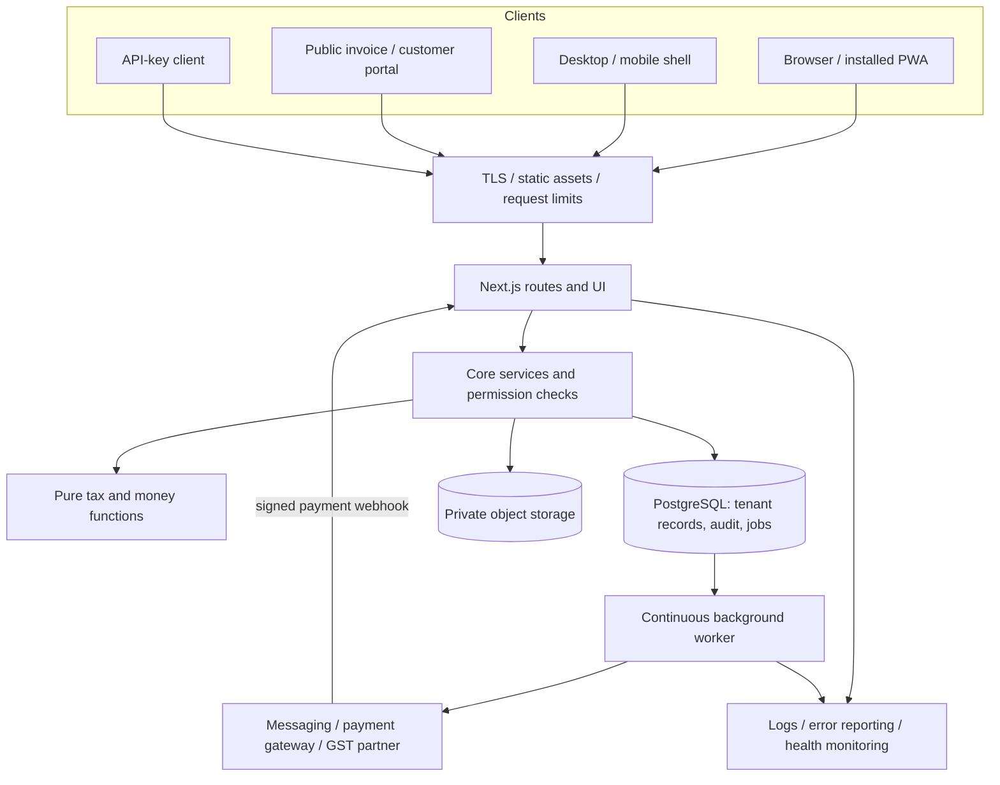
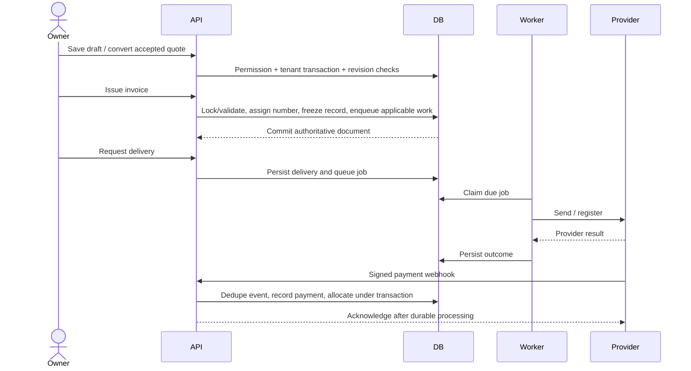

# Kora end-to-end system design

Design review: 24 October 2026. Repository baseline: d8aa1d2. This is an implementation-grounded design and execution plan, not a certification of production readiness. Hosting accounts, production traffic, credentials, backups and provider contracts were not inspected. Existing behavior, proposed changes and operational requirements are distinguished below.

## 1. Product boundary and architecture decision

Keep Kora a modular monolith with independently deployed web and worker processes. PostgreSQL remains the source of truth for business records, money, authorization and queued work. Browser, PWA, Electron and Capacitor clients use the same server contracts. Desktop/mobile packaging does not create an independent accounting engine.

The critical journey is: sign in, select business, create customer/items, quote, accept/convert, draft invoice, issue, render/share, collect payment, reconcile and report. Retail stock, projects, purchases, CA workflows and customer portals extend this journey through core services. They must not implement separate numbering, payment or tax engines.

Do not split into microservices until measured bottlenecks or separate ownership require it. Separate PDF/export execution before splitting the transactional financial model. Avoid adding Kafka or a second queue merely for anticipated scale.

## 2. System context and trust boundaries

Client input is untrusted. Tenant identity comes from the authenticated membership, not a submitted business ID. Public links grant narrowly scoped access and must remain revocable. Provider callbacks are untrusted until signature verification. Operator routes and cross-tenant jobs are privileged system boundaries. Object keys are not authorization credentials.

Public utility tools are a separate, anonymous client-side boundary. Keep local image/PDF/text transformations separate from authenticated accounting services. Bound file sizes and processing memory, release object URLs, and avoid uploading user files unless a specific tool explicitly requires and discloses it. The latest main includes these browser tools; they do not become authoritative invoice records.

## 3. Module and data ownership

| Domain | Implementation anchor | Owns / contract |
|---|---|---|
| Authentication | `packages/core/src/auth.ts`, `apps/web/lib/server.ts` | Login, session resolution and cookies; tenant membership checked separately |
| Authorization | `packages/core/src/tenancy.ts`, `permissions.ts`, `packages/db/src/index.ts` | Transaction-local tenant/user settings plus RLS and operation permission |
| Documents | `documents.ts`, `estimates.ts`, `conversions.ts` | Draft revisions, issue/cancel, quote conversion; database triggers protect issued records |
| Money | `packages/tax/src` | Integer paise, tax/rounding rules; JSON money serialized as decimal strings |
| Collections | `payments.ts`, `credit.ts`, `payment-history.ts` | Payments, allocations, credit and refunds; document balance is derived through the accounting rules |
| Scheduling | `jobs.ts`, `tick.ts`, `recurring.ts`, `reminders.ts` | Durable work and recurring occurrence processing |
| External services | `packages/adapters/src` | Provider-specific APIs behind testable interfaces |
| Documents for humans | `packages/pdf/src` | HTML/PDF rendering from authorized document data |
| Files | `blobs.ts`, `attachments.ts` | Private files; object storage when configured, database fallback otherwise |
| Offline | `apps/web/lib/offline.ts`, `sync.ts`, `public/sw.js` | Local draft staging, retry and explicit revision-conflict handling |
| Reporting | `reports.ts`, `reports-extra.ts`, `gstr.ts` | Read projections and exports; never an alternative ledger |

Primary relationship: business -> party/item/document; document -> lines, delivery and share links; payment -> allocations -> document. Recurring profiles create documents. Jobs carry references to these records. Audit is append-only. Exact SQL schema is in [database.md](database.md); do not duplicate its table definitions here.

## 4. Request and workflow contracts

### Sign-in and tenant switching

Resolve the session, then the selected business and membership, then enforce the operation permission. Enter `inTenant`/`withTenant` before tenant queries. `set_config(..., true)` confines context to a transaction, preventing pooled connections from leaking another tenant's context. Cookie flags include HttpOnly, SameSite=Lax and Secure in production. State-changing authenticated routes require JSON. Review exceptions such as uploads and public actions independently.

Business switching must also isolate local drafts and cached data. Gate acceptance on two-business tests, including removed memberships and concurrent tabs. RLS does not protect data already downloaded onto a shared device.

### Quote to paid invoice

Document status and payment status are different state machines. A failed message does not undo an issued invoice. An issued invoice is not necessarily paid or successfully registered with a GST partner. Corrections use supported notes/cancellation flows, not mutation of issued totals. A browser success redirect is not proof of payment.

`recordPayment` locks the invoice and validates remaining balance. Gateway event deduplication exists; this does not imply every manual-payment POST is replay-safe. Proposed contract: client-generated operation key for manual money mutations, unique per tenant and operation, request-hash comparison and persisted response in the same transaction. Retry with the same key returns the original result; same key with a different request conflicts. Do not deploy this without simultaneous-request and lost-response tests.

### Offline draft sync

Existing sync sends `clientRef` and optional `baseRev`. A successful save removes the local draft; 401 pauses it; revision conflict leaves it for user resolution; 429/5xx/network failures return it to pending. Web Locks serialize supported browsers across tabs; fallback locking is per JavaScript instance only. Server-side idempotency remains necessary.

Only drafts are offline work. Issue, payment posting, GST registration and authoritative numbering require connectivity. Do not label installation as complete offline accounting. Before enabling broader offline caching, verify logout, tenant switch, revoked access and shared-device behavior.

### PDF, files and exports

Current PDFs run through Chromium and exports can be memory-heavy. Keep authorization at the download boundary. Never globally cache tenant PDFs by a route alone. Proposed immutable PDF cache key: tenant ID + document ID + content/template version + locale. A document's current balance can change; distinguish an immutable issued document from a live statement or payment view. Private files require authorized reads or short-lived signed links.

Move large exports/PDF batches into jobs when measured duration or memory approaches host limits. Persist status, object key and expiry; return an authorized job-status URL. Do not hold a database transaction while rendering a PDF or uploading an object. Reconcile orphaned objects from failed writes, with a grace period and dry-run inventory before deletion.

## 5. Consistency, retries and queue design

Implemented: job insertion can share the business transaction, active-job deduplication, `SKIP LOCKED` claims, retry delay and terminal failure. `0004_collections.sql` requeues jobs locked longer than ten minutes. `runJobsOnce` claims up to ten jobs and handles them sequentially.

The delivery guarantee is **at least once**, not exactly once. A provider can accept a send and the worker can crash before recording success. Row locks and queue dedupe do not close that external side-effect gap. In addition, completion updates currently match job ID alone: a stale worker could overwrite a newer claim after lease expiry.

Proposed queue hardening, before increasing worker concurrency:

1. Introduce a fresh lease token per claim in a forward migration. Completion, failure and retry updates must compare ID and lease token.
2. Claim only available execution slots, or heartbeat queued-in-memory claims. Keep provider timeouts below the lease and avoid claiming ten slow jobs into one serial loop.
3. Supply a stable delivery operation ID to providers that support idempotency. Otherwise preserve provider receipt IDs and reconcile ambiguous outcomes; clearly expose possible duplicates to operators.
4. Enforce attempt exhaustion for repeated lease expiry, not only caught handler exceptions.
5. Treat cron `budgetMs` as cooperative: it checks between batches and cannot cancel an in-progress batch. Use deadline-aware claiming plus request timeouts; do not assume 40 seconds is a hard bound.
6. Retry temporary failures with bounded backoff and jitter. Permanent validation failures go to operator-visible failed state. Replay requires cause analysis, not a blind reset of every job.

Test gates: crash after send, crash before acknowledgement, expired worker completing late, two simultaneous workers, provider timeout, exhausted attempts and transaction rollback leaving no queued event.

## 6. Deployment and operating model

Current repository: web cron in `apps/web/vercel.json` runs daily at `30 4 * * *`; `.github/workflows/tick.yml` additionally calls the tick every five minutes when its secrets are configured. A continuous worker exists separately. Scheduled Actions may start late, so this fallback does not establish a 60-second job-start objective. Workflow existence does not prove activation or a live worker deployment.

Target: web process + continuously running worker + managed PostgreSQL + private object storage. Keep web/worker near the database. Use separate runtime and migration credentials; runtime must not bypass RLS. A scheduler can be a fallback only when cadence, execution budget and host limits satisfy delivery targets. Do not change hosted schedules or provision paid infrastructure as part of this document.

Database connection budget: sum of (maximum web instances x pool size) + worker pools + migration/monitoring reserve must remain below the usable database connection ceiling. Web currently defaults to pool size 10 and worker to 5. Measure actual concurrency before choosing instance counts. Transaction pooling requires transaction-local tenant context; port-based prepared-statement detection is not a complete provider configuration contract.

Deploy additive schema first, compatible application second, cleanup later. `runMigrations` applies all pending SQL files inside one transaction under an advisory lock. Long blocking migrations require an explicit maintenance/rollout strategy. Roll back application code while retaining additive columns; never drop money records to make an old build work.

## 7. Security and privacy acceptance criteria

- Two tenants cannot read or mutate each other's records, attachments, exports or cached pages, even with guessed IDs.
- Removed members lose server access immediately; local-data handling on shared devices has a documented policy.
- Payment callbacks validate raw-body signatures and provider event identity. Never trust amount or business selection from browser callbacks.
- Public links and portal grants are scoped, revocable and excluded from analytics/log payloads.
- Secrets and full invoice/customer payloads are excluded from ordinary logs. Log correlation ID, operation ID, sanitized error code and appropriate tenant identifiers.
- Outgoing webhook destinations enforce public-address checks through connection time. Document permitted redirects and DNS behavior in provider tests.
- Sensitive files stay private; export permissions are checked separately from ordinary read permissions.
- Production mock adapters, fixed OTP and private-webhook overrides must be disabled. Provider account setup and live credentials remain operational checks.
- Backup credentials and encryption keys are separated from runtime credentials. Retention/deletion behavior must account for invoices, local caches, blobs and backup expiry.

These are release gates, not a claim that every item has been tested in this review.

## 8. Capacity and performance model

Planning assumptions, not measured capacity: 1,000 daily active businesses x 100 invoices/day = 100,000 invoices/day, about 1.16 issues/second on average. A 20x peak is about 23 issues/second. Reads, line inserts, audit writes and payments multiply load; size using realistic invoice line counts and bursts rather than this average.

If one external job occupies a serial slot for 500 ms, ideal throughput is at most 2 jobs/second per slot before database/network overhead. At five seconds it is 0.2. This explains why queue age and provider latency determine concurrency. Benchmark before setting worker counts or promising throughput.

Proposed objectives: p95 ordinary API response below 500 ms under an agreed workload; p95 PDF below 5 seconds for a normal invoice; p95 due-job start below 60 seconds with an active worker. These exclude provider completion delays and are acceptance targets, not observed service levels. Capture cold starts separately. Set report limits and pagination before raising concurrency.

Scale in order: measure slow queries and queue age; add evidence-based composite indexes; bound pagination/export sizes; isolate PDF/export CPU; increase worker slots with lease fencing; add read projections for reports. Keep payments and numbering on the primary database. Introduce replicas only for explicitly stale-tolerant reads.

## 9. Observability, recovery and incident handling

| Signal | Proposed trigger | Response |
|---|---|---|
| Oldest due queued job | More than 2 minutes for 5 minutes | Check worker, provider latency and retry errors |
| Expired running lease | More than 10 minutes | Investigate ambiguous side effects before replay |
| API errors | Over 1% for 5 minutes, with a minimum traffic count | Group by route/error code; correlate deploy and DB failures |
| Payment mismatch | Any confirmed provider payment missing local reconciliation | Reconcile by provider ID; never fabricate a browser payment |
| Worker health | Unhealthy twice | Check logs and DB/provider reachability; avoid restart loops |
| Backup freshness | Older than 26 hours | Alert operator and inspect backup workflow/storage |
| Restore drill | No successful drill in 30 days | Restore into isolated DB and reconcile ledger totals |

Current worker health measures loop progress, not full dependency readiness. The web health route checks database reachability, unsafe production mock flags and schema status; missing migration files produce `schema: unknown`, which is not rejected. `.github/workflows/watch.yml` checks health and queue state every 15 minutes when configured; missing secrets skip the check. Its evaluator catches failed jobs and old queued jobs, but does not detect expired running leases. Workflow-failure notification delivery must be verified. Do not present a healthy loop as proof that messages are delivered. Add low-cardinality metrics for retries, permanent failures, queue age, PDF memory/duration, DB pool wait and sync conflicts.

Proposed recovery targets: RPO <=15 minutes and RTO <=4 hours only after point-in-time recovery and rehearsals support them. Daily logical backups alone imply up to roughly 24 hours of data loss and cannot satisfy that RPO. The repository backup workflow is gated by `BACKUPS_ENABLED`; its actual activation and restore history are unknown.

Runbooks:

- Provider outage: keep committed invoices, show delivery pending, throttle retry, surface queue age, restore provider access, replay only eligible failures.
- Database outage: fail financial writes clearly, keep local drafts, do not number or mark paid client-side. After recovery reconcile webhook retries and due schedules.
- Bad deployment: roll back compatible app, retain additive schema and queued jobs, inspect any partially completed external operations.
- Restore: isolate a fresh database, restore DB plus referenced blobs, check tenant isolation and ledger totals, reconcile provider payments since the recovery point, approve cutover, resume workers last to avoid duplicate sends.

### Current operational additions

- Migration `0170_retention_prune.sql` deletes done jobs after 30 days, failed jobs after 90 days, processed gateway events after 180 days and finished webhook deliveries after 90 days. Expired auth records have separate windows. Issued documents, payments and audit records are excluded.
- Tick cleanup runs during the 21:00 UTC hour; multiple calls can occur in that hour. Verify an active scheduler reaches that hour, and monitor pruning failures and lock duration.
- Before relying on the 180-day event window, test replay of an old gateway payment after event cleanup against durable payment uniqueness. Do not interpret operational retention as a financial-record retention policy.
- Shared request limiting has a PostgreSQL fallback when the optional external limiter fails. Verify failure behavior under concurrent traffic and database pressure.
- GST partner construction is lazy, so missing GST configuration no longer needs to block unrelated app operations. Provider-backed actions still require valid configuration.

## 10. Prioritized implementation plan

| Priority | Deliverable | Completion evidence | Dependency |
|---|---|---|---|
| P0 | Verify continuous worker and delivery cadence | Test invoice delivery completes inside measured target; alert fires when worker stops | Hosting configuration |
| P0 | Queue lease fencing and deadline-aware batches | Crash/late-completion/concurrent-worker tests pass | Additive migration + core changes |
| P0 | Payment replay contract and reconciliation | Repeated/concurrent operation returns one payment; provider mismatch test | API and client operation IDs |
| P0 | Backup and restore drill | Dated isolated restore report, totals and blob verification | Operator storage credentials |
| P1 | Tenant/offline lifecycle verification | Shared-device, logout, business-switch and lost-response tests | Browser + DB suite |
| P1 | Alerts and sanitized correlation IDs | Induced failures produce actionable alerts without secrets | Monitoring configuration |
| P1 | PDF/export resource budgets | Load test and memory report; async fallback for large requests | Measured production-like workload |
| P1 | Provider readiness and accurate public claims | Live sandbox reconciliation and owner-approved availability copy | Provider accounts |
| P2 | Reporting projections and query tuning | Explain plans and before/after workload measurements | Production query profile |
| P2 | Desktop/mobile release assurance | Signed builds, tested update path, permissions and installation evidence | Release credentials |

Execute these gates through the bounded PRs in [system-design-phases.md](system-design-phases.md). Phase 1 is this design refresh; implementation phases remain pending.

Do not start all rows concurrently. Finish P0 delivery correctness and recovery before expanding feature breadth. Each implementation PR needs tests for its own failure modes and a rollback note. Existing CI is broad, but a green suite does not establish hosting configuration or real-provider readiness.

## 11. Decisions and verification record

Accepted for design: modular monolith; one authoritative financial database; adapter boundaries; at-least-once background delivery; offline drafts only; operational release gates. Deferred: microservices, additional queue infrastructure, broad offline issuance and unmeasured scaling.

This pass inspected source for tenancy, payment locking, queue claims/retries, cron cadence, worker loop/health, provider delivery, blob storage, offline sync, CI and backups. It corrected inaccurate queue and migration guarantees in architecture documentation. No production account was modified, no database migration ran, and no money-path behavior changed. See [system-design-review.md](system-design-review.md) for the bounded findings and validation.
